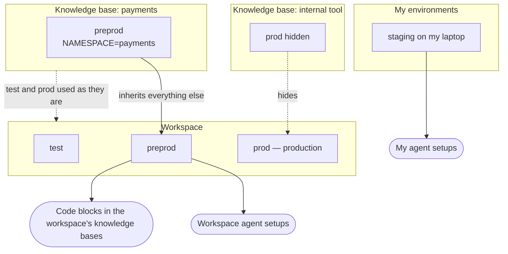
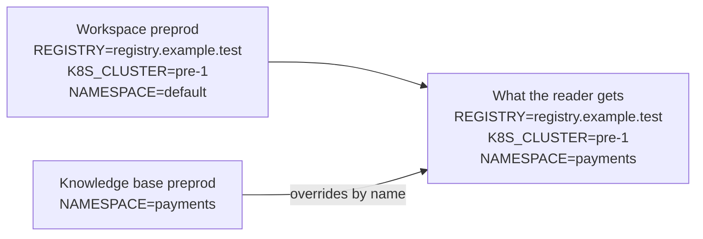

# Environments and stands

An environment is a named, versioned set of variables: everything a stand is made of. `test`, `preprod` and `prod` are the usual three; `my laptop` or `demo` work just as well. Each variable has a name, a kind (see *Kinds of variables and secrets*) and, for most kinds, a value.

Two things read an environment:

- **documentation** — a reader picks a stand at the top of a knowledge base, and code blocks are copied with that stand's values put in;
- **agents** — an agent setup names an environment, and the agent and its setup script get its variables.

## Who owns an environment

| Owner | Where | Read by | Edited by |
|---|---|---|---|
| Workspace | Workspace settings → **Environments** | every knowledge base of the workspace, the workspace's agent setups | owners and admins |
| Knowledge base | Knowledge base → **Connections** → **Environments** | that knowledge base's code blocks | its admins |
| You | Settings → **Agents** → **My environments** | your own agent setups | you |

## Inheritance: set once, override what differs

Most values are the same for every knowledge base of a workspace: the registry, the cluster, the SSO host. So the workspace's environments are the base ones.

- A knowledge base with no environments of its own simply uses the workspace's, in the workspace's order.
- **Override** on an inherited environment makes the knowledge base's own copy that stores only what differs — typically `NAMESPACE`. Everything else keeps coming from the workspace, including later changes.
- A knowledge base can add variables the workspace does not have, or make an environment of its own with no base (`demo`).
- **Hide** removes an inherited environment from one knowledge base — an internal tool with no `prod`.
- **Lock** a workspace variable that must not differ — `SSO_HOST` on prod, say — with **Knowledge bases may not override it** under the variable. A knowledge base then shows it read-only with a lock, and a reader's own value does not replace it in a copied command.
- The link is by identity, not by name: renaming the workspace's `preprod` does not break the knowledge bases built on it.

## Production

Mark an environment **Production** and it is shown in red wherever it is picked; code blocks filled from it get a red stripe, and running a command from one in the desktop terminal asks first, showing the command.

## Versions

Every save is a new version. A task an agent is working on keeps the version it started with, so changing `preprod` does not change the values under a running task; the next task gets the new ones.

## Who sees what

- **Names** of environments and variables: anyone who may read the knowledge base, including anonymous readers of a public one. A page has to be able to say what it would fill in.
- **Values**: members only. Anonymous readers of a public knowledge base never get them.
- **Secrets**: not shown to people at all. On a test stand a secret can be let out with **Those who manage it may show it**: then the people who may edit the environment get an eye button that shows it, and every showing is written down (who, which variable, which version, never the value). Leave it off for production keys.
