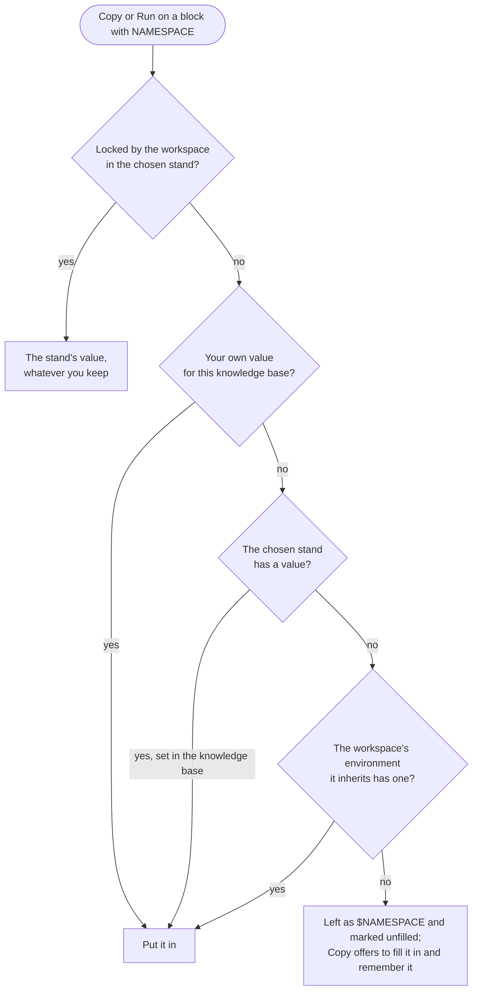
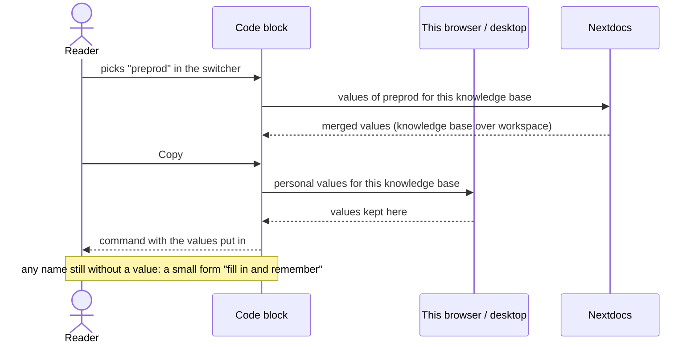

# Variables in code blocks

Documentation is full of commands like `kubectl -n $NAMESPACE get pods`. Without help, every reader copies the command and edits it by hand for their stand. With variables, the author marks `NAMESPACE` once, and each reader copies the command with their own value already in it.

## For the author: marking a variable

Select the token in a code block and press **Make the selection a variable** in the toolbar. Only names marked this way are ever replaced: in shell, Helm or Jinja a `$X` often has to stay as it is, so nothing is replaced automatically.

The forms recognised for a marked name `NAME` are `$NAME`, `${NAME}`, `<NAME>`, `{{NAME}}` and `{{ NAME }}`.

The text of the block does not change. In markdown — on GitHub, in an export — the block stays a valid command, and the marked names are kept after the language:

````
```bash vars=API_HOST,NAMESPACE
kubectl -n $NAMESPACE port-forward svc/api 8080 && curl https://$API_HOST/health
```
````

## For the reader: where a value comes from

Pick a stand with the environment switcher at the top of the knowledge base. Then, for each marked name, the first value found wins:



A variable the workspace locked is the exception: the stand's value always wins, so `SSO_HOST` on prod cannot be swapped by a value someone kept from another stand.

## What happens when you press Copy



## Where your own values are kept

Personal values never go to Nextdocs:

- in the **desktop app** they are kept by the system keychain, secrets included;
- in the **browser** they stay in that browser only, and only values that are not secret.

The stand you picked is also remembered per knowledge base in the browser or the app.

## Agents and code blocks

When an agent reads a page it gets the text as written, the names marked in each block and the names of the knowledge base's environments — never the values. An agent working on a task gets values only through its agent setup (see *Agent setups*).
