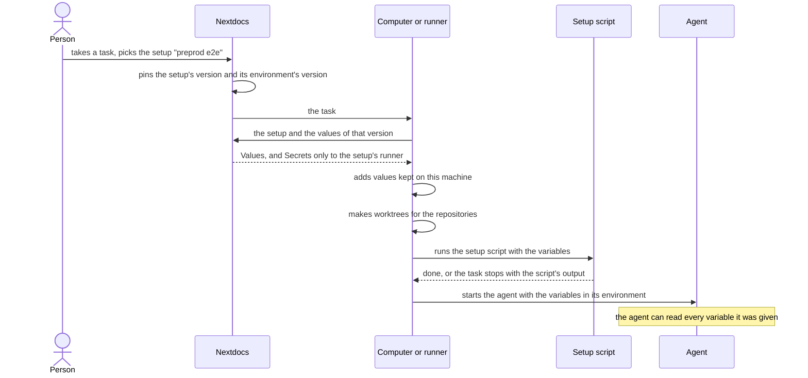
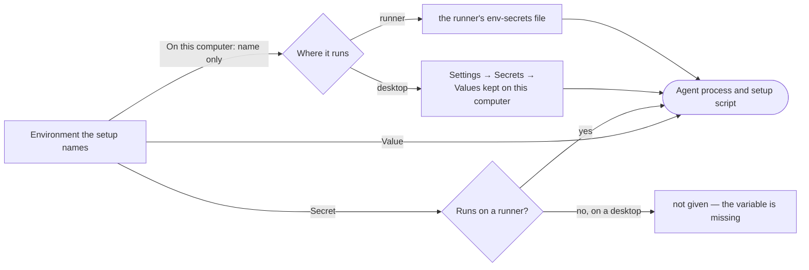

# Agent setups

An agent setup says **where** an agent works on a task. It is picked when a task is taken or handed to a runner.

| Field | What it decides |
|---|---|
| **Where** | The computer that takes the task, or a connected runner |
| **Network access** | Full, limited to a list of domains (package managers optional), or none |
| **Setup script** | Commands run in the task folder before the agent starts — `pnpm install`, `docker compose up -d postgres` |
| **Values from** | The environment whose variables the agent and the script get |
| **Repositories** | Only these may be planned and changed; empty means any |

A setup keeps **no values of its own**. It names one environment of the same owner — a workspace setup one of the workspace's environments, your own setup one of **My environments** — so `preprod` for an agent is exactly `preprod` for a reader of the documentation. To change a value, edit the environment; every setup that names it picks the change up for its next task.

## From taking a task to the agent starting

The versions are pinned when the task is taken: editing the setup or its environment later does not change a task already under way.

## Which values reach the agent

The setup form warns when this happens: a **Secret** in the chosen environment does not reach a setup that runs on the computer taking the task. Keep such a variable **On this computer**, or run the setup on a runner.

Some names are kept by the runner itself and cannot come from an environment a setup uses: `PATH`, `HOME`, proxy settings and anything starting with `ANTHROPIC_`, `OPENAI_`, `GIT_`, `GITHUB_`, `NEXTDOCS_` and the like. A setup refuses such an environment until the variable is renamed.

## The network and what it is not

On a computer or a runner, limited or no network is an agreement with the agent — it is told the rule — not isolation: a program that ignores the rule is not stopped. Isolation comes with cloud containers.

## Setups made before

A setup saved before setups took values from environments may show **Its own variables** under **Values from**. It keeps working as it was; pick an environment to move it over.
