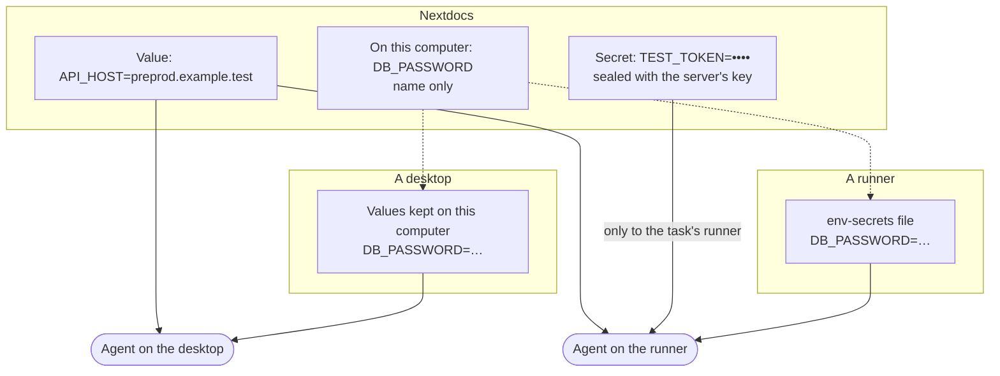

# Kinds of variables and secrets

Every variable of an environment is one of three kinds. The kind decides where the value is kept and who can ever get it.

| Kind | Where the value is | Readers of code blocks | Agent on a runner | Agent on a desktop |
|---|---|---|---|---|
| **Value** | In Nextdocs, as typed | members get it | gets it | gets it |
| **Secret** | In Nextdocs, sealed; never shown again | no; those who manage it may show it if allowed, logged | gets it | **does not get it** |
| **On this computer** | Only on each computer or runner; Nextdocs has the name | their own value, if they set one | from its env-secrets file | from **Values kept on this computer** |

## Why a secret does not reach a desktop

The desktop app talks to Nextdocs with your own sign-in, and so does the web page. If a sealed secret were handed to that sign-in, any page open under it could read it back. So sealed secrets go only to a runner, which has its own identity, and only for the task it is running. On a desktop, keep a secret **On this computer** instead.

## Values kept on this computer

Settings → **Secrets** → **Values kept on this computer** (desktop app) lists every **On this computer** variable your environments declare, with **set** or **missing** next to each, and which environment needs it. Press **Set** on a missing one to give it a value. Values are encrypted by the system keychain and leave the computer only into the agent runs it starts.

The same name serves every environment that declares it: `DB_PASSWORD` set once here is used by any environment with an **On this computer** variable of that name.

On a runner, the same values go into the `env-secrets` file in its data folder, which must be readable by its owner only.

## The agent can read them

Every kind ends up as an ordinary environment variable of the agent's process. The agent can read it, print it, and use it in any command. Keep to test credentials in environments. When an agent has to use a login or a key **without** seeing it, it belongs in *Credentials*.

What a run sends to people watching it from elsewhere has the exact values of its secrets and its values kept on the computer — those six characters or longer — replaced. This catches accidents, not an agent determined to leak a value, and it does not stop the agent itself from using the value.
