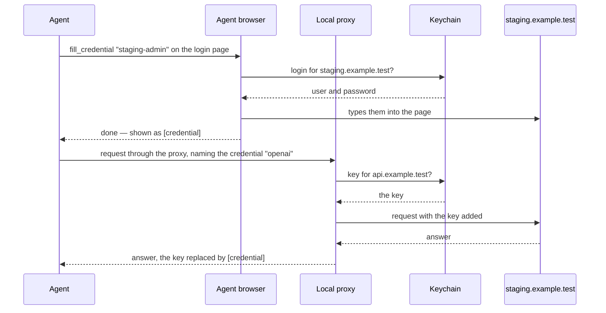
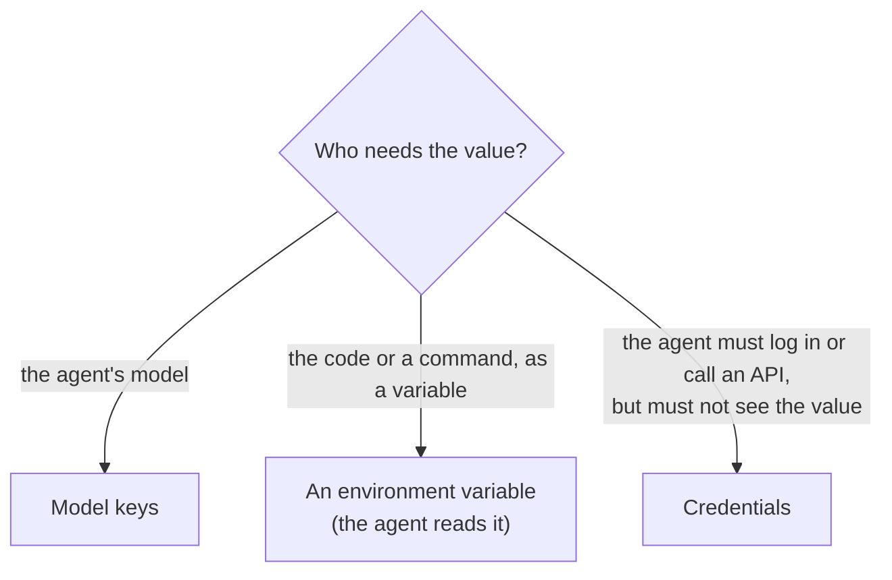

# Credentials and model keys

Two kinds of keys live in Settings → **Secrets** of the desktop app and are not environment variables at all. Both stay on this computer, encrypted by the system keychain; Nextdocs never gets them. The difference is who uses them and whether the agent can read them.

| | Credentials | Model keys |
|---|---|---|
| For | Other sites the agent works with in a task — a staging admin login, a payment provider's test key | The agent itself, to reach its model — `ANTHROPIC_API_KEY`, `OPENAI_API_KEY`, `GEMINI_API_KEY`, `XAI_API_KEY` |
| Used by | The agent's browser and a local proxy | The agent CLI |
| The agent sees the value | **No** — only the name and the sites | **Yes** — it is in the agent's environment |
| Asks first | Before a credential is used on a site in a chat, unless turned off | No |
| Billing | — | Runs are billed to the key, even where the CLI is signed in to a subscription |

## Credentials: used without being read

A credential is bound to its sites: the browser fills it only on a page of one of them, and the proxy adds it only to requests to them. Anything that comes back to the agent shows the value as `[credential]`.

## Model keys: instead of signing in

A model key is the alternative to signing in to an agent's CLI. Leave a provider empty if you use its subscription: a key here takes over and the runs are paid from it. With a key, an agent can be picked even when its CLI has no sign-in of its own.

The key goes into the agent's environment, so a command the agent runs can read it.

## Which one to use

