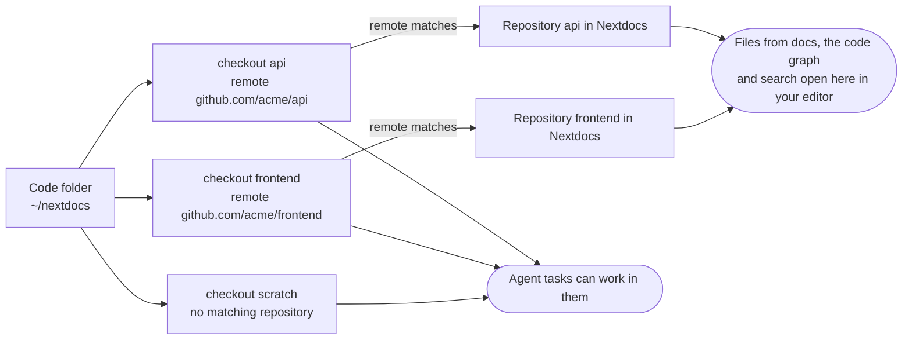

# Code on this computer

Settings → **Desktop** → **Code on this computer** tells the desktop app where your checkouts are. It is kept only on this computer; Nextdocs never learns the paths.

## Folders, checkouts, repositories

1. **Add folder…** — point at a folder that holds several checkouts. The app finds every git checkout inside it.
2. **Agent tasks** see every checkout found. The note under a folder ("Nextdocs: all service repos; frontend is nextdocs-front") is handed to agents as they plan.
3. **Linking.** A checkout whose remote is a repository in Nextdocs is linked to it automatically; those are green in the list of checkouts. A grey one has no repository in Nextdocs with that remote — it is still available to agent tasks, it just has nothing to link to.
4. **Repositories linked to a folder here** lists the links. **Change** points a repository at another folder, **Unlink** removes the link. A repository can also be linked by hand from its own page.

**Picked by hand before** lists single checkouts you chose earlier outside any code folder; remove them once a code folder covers them.

## When it is used

- **Taking a task** — the task's worktrees are made from the checkouts found here.
- **Open in editor** — a file location from documentation, the code graph or a search hit opens in the editor chosen under **Editor**, inside the linked folder.
