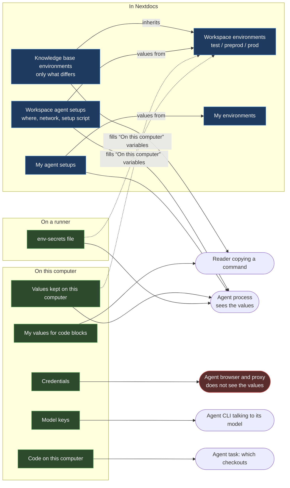

# Environments, agent setups and secrets

Several settings in Nextdocs hold values: environments, agent setups, credentials, model keys, values kept on a computer, code folders. Their names sound alike, but each answers a different question. This page lays them all out on one picture; the pages under it go through each one, with what happens at the moment it is used.

## The picture

Blue is kept in Nextdocs, green only on a device, red is the one way an agent uses a value without seeing it.

## Two ideas that keep it apart

**An environment is values, an agent setup is a place.** An environment (test, preprod, prod) is a named set of variables — `API_HOST`, `NAMESPACE`, a test token. An agent setup says where an agent works: which computer, what network it may reach, what script runs before it starts, which repositories it may touch. A setup holds no values of its own: it names an environment. So "preprod" is defined once, and a reader copying a command from the documentation and an agent working on a task get the same values.

**What matters about a secret is whether the agent can read it.** Everything an agent gets in its process — the variables of its environment, values kept on the computer, model keys — it can read, print and send on. Only credentials are used for it without being shown to it.

## Where to put what

| You have | Put it in | Who uses it | Agent can read it |
|---|---|---|---|
| A stand's host, namespace, registry | Environment, **Value** | Readers of code blocks, agents | yes |
| A test token everyone in the workspace may use | Environment, **Secret** | Agents on runners; its managers may show it if allowed | yes, on a runner |
| A password each person or machine has its own | Environment, **On this computer** + the value on each computer | Agents on that computer or runner | yes |
| A login or API key for another site the agent should use but not see | **Credentials** | The agent's browser and proxy | **no** |
| An API key for Claude, OpenAI, Gemini, xAI | **Model keys** | The agent CLI itself | yes |
| Where your checkouts are | **Code on this computer** | Agent tasks, "open in editor" | — |

## Where each one is in the settings

| Setting | Where | Kept |
|---|---|---|
| Workspace environments | Workspace settings → **Environments** | Nextdocs |
| Workspace agent setups | Workspace settings → **Agents** → **Agent setups** | Nextdocs |
| Knowledge base environments | Knowledge base → **Connections** → **Environments** | Nextdocs |
| My environments, my agent setups | Settings → **Agents** | Nextdocs, under your account |
| Credentials, model keys, values kept on this computer | Settings → **Secrets** (desktop app) | This computer, encrypted by the system keychain |
| Code on this computer | Settings → **Desktop** (desktop app) | This computer |

Every block in the settings that holds values ends its description with the same three lines — **Used by**, **Kept**, **The agent** — so two of them can be told apart without reading both paragraphs.

## The pages under this one

- **Environments and stands** — workspace, knowledge base and personal environments; inheritance, locked and production variables.
- **Variables in code blocks** — how an author marks a variable and where a reader's value comes from.
- **Agent setups** — what happens between taking a task and the agent starting.
- **Kinds of variables and secrets** — Value, Secret, On this computer: who gets each one.
- **Credentials and model keys** — the two kinds of keys that are not environment variables.
- **Code on this computer** — code folders and repositories linked to them.
