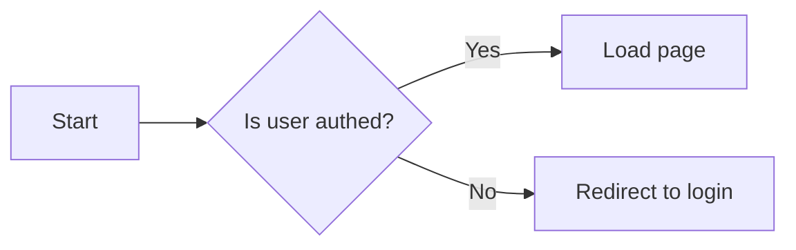

# Диаграммы: Mermaid, TLDraw, Excalidraw

## Зачем это нужно

Документация без диаграмм скучная и малопонятная. Архитектура\
системы, поток данных, пользовательский сценарий — всё это\
объясняется на картинке в разы быстрее, чем в десяти абзацах текста.

Nextdocs даёт три разных способа рисовать. Все они живут прямо в\
странице — не нужно никаких внешних инструментов, внешних файлов или\
скриншотов.

## Какой инструмент когда выбрать
| Инструмент | Формат ввода | Подходит для | Не подходит для |
| -- | -- | -- | -- |
| **Mermaid** | Текстовый DSL | Flow-чарты, sequence diagrams, ER, гантты, state machines — **когда структура важнее эстетики** | Свободного рисования, произвольных форм |
| **TLDraw** | Мышь / тачпад | Схемы архитектуры, wireframes, UI-макеты — **геометрически точные диаграммы** | Текстовой DSL-диаграммы (flowchart и т.п.) |
| **Excalidraw** | Мышь / тачпад | Скетчи, whiteboard-наброски, эскизы — **hand-drawn стилистика** | Точных технических схем (выглядит «рукописно») |

Общее правило: если диаграмму хочется редактировать в PR-ревью — берёте Mermaid (она в git diff видна). Если хочется быстро накидать «идею на салфетке» — Excalidraw. Если нужна точная схема с выравниванием и притягиванием — TLDraw.

## Mermaid

### Как вставить

1. В слеш-меню выберите **Code**.

2. В правом верхнем углу блока — выпадающий список языков. Выберите\
   `mermaid`.

3. Вводите код диаграммы:

Под блоком сразу рендерится картинка. Редактируете код — картинка\
перерисовывается в реальном времени.

### Что умеет Mermaid

* **flowchart** / **graph** — стрелочные схемы (LR/TB направления).

* **sequenceDiagram** — взаимодействие участников во времени.

* **classDiagram**, **classDiagram-v2** — UML-классы.

* **erDiagram** — ER-модели БД.

* **stateDiagram**, **stateDiagram-v2** — конечные автоматы, в том числе\
  с вложенными состояниями.

* **gantt** — расписания и планирование.

* **pie** — круговые диаграммы.

* **journey** — пользовательский сценарий.

* **quadrantChart**, **xychart**, **radar-beta**, **sankey**,\
  **treemap** — графики.

* **mindmap**, **timeline**, **kanban**, **block**, **packet** —\
  структура и раскладка.

* **architecture-beta** — сервисы и группы, с иконками.

* **gitGraph** — ветки и мерджи.

* **requirementDiagram** и набор C4 (**C4Context**, **C4Container**,\
  **C4Component**, **C4Dynamic**, **C4Deployment**).

Двух типов самого Mermaid здесь нет: **zenuml** (нужен отдельный плагин\
Mermaid) и баннер **info**. `architecture` и `radar` работают только в\
написании с `-beta`, а `kanban-beta` не существует — пишите `kanban`.

Полная грамматика — на <https://mermaid.js.org>.

### Подсказки

* Всегда указывайте направление в flowchart (`LR`, `TB`, `RL`, `BT`)\
  — без него разные версии Mermaid рендерят по-разному.

* Комментарии начинаются с `%%` — удобно оставлять пояснения для\
  коллег, которые будут редактировать схему позже.

* Ошибка в синтаксисе отображается прямо в блоке: красным выделена\
  строка и токен, на которой всё сломалось, с подсказкой чего\
  ожидалось.

### Коллаборация

При редактировании Mermaid-блока коллеги видят ваш курсор (в коде, не\
на SVG). Картинка перерисовывается у всех автоматически.

## TLDraw

### Как вставить

1. В слеш-меню — **Diagram**.

2. Появится встроенный холст \~400 пикселей высотой.

3. Рисуете: выберите инструмент слева (прямоугольник, эллипс, стрелка,\
   текст), кликаете-тащите по холсту.

4. Для полноценной работы — нажмите иконку «расширить» в правом\
   верхнем углу. Откроется на всё окно.

### Что умеет TLDraw

* Геометрические фигуры с точным позиционированием.

* Притягивание (snapping) к другим фигурам.

* Стрелки с привязкой к фигурам — при движении фигур стрелки остаются\
  подключены.

* Изображения — можно вставить скрин архитектуры и подрисовать\
  аннотации.

* Несколько страниц-слоёв внутри одной диаграммы (снизу —\
  переключатель).

* Экспорт в PNG/SVG.

### Коллаборация

Работает в реальном времени: видны курсоры коллег, все изменения\
применяются синхронно. Двое могут одновременно таскать разные\
фигуры — конфликтов нет.

## Excalidraw

### Как вставить

1. Слеш-меню — **Excalidraw**.

2. То же — встроенный холст, fullscreen по иконке.

### Отличие от TLDraw

* **Стилистика hand-drawn** — линии «неровные», с вариацией. Визуально\
  напоминает быстрый набросок на whiteboard.

* **Картинки-наклейки** — иконки, эмоджи, готовые элементы.

* **Экспорт в SVG/PNG** с сохранением рукописного стиля.

Excalidraw лучше подходит для коммуникации идеи «в разговоре»:\
«Смотри, это фронт, это бэк, стрелка — запрос». Для строгой\
документации, которая останется на годы — предпочтительнее TLDraw\
или Mermaid.

### Коллаборация

Тоже в реальном времени, включая живые курсоры участников.

## Поиск по диаграммам

Внутренний поиск Nextdocs ищет по текстовому содержимому диаграмм:

* **Mermaid** — по исходнику (названия узлов, метки стрелок).

* **TLDraw** — по тексту внутри фигур (label, name, rich text).

* **Excalidraw** — по тексту в text-элементах, label'ах фигур,\
  именах frame'ов.

То есть если вы подписали прямоугольник словом «Auth Service»,\
глобальный поиск (Cmd/Ctrl+K) найдёт эту диаграмму по запросу\
«Auth».

Поиск в Google на публичной документации диаграммы **не** индексирует\
как изображения — только текст вокруг и подписи.

## Полноэкранный режим

Кнопка «расширить» (иконка в правом верхнем углу любой диаграммы)\
разворачивает редактор на весь viewport. ESC или повторный клик —\
выход.

В fullscreen удобно работать с большими диаграммами; вне fullscreen\
— быстро посмотреть и чуть-чуть подправить.

## Ограничения

* **Mermaid**: 2 МБ на блок. Очень большие графы могут подтормаживать\
  при редактировании.

* **TLDraw / Excalidraw**: снапшот хранится в атрибутах страницы,\
  рекомендуемый размер одной диаграммы — до \~1 МБ (это очень много\
  фигур, на практике редко нужно больше).

* **Экспорт диаграмм в PDF** — делается через общий экспорт страницы\
  (PDF собирается из всего контента, диаграммы растрируются).

* **Импорт Excalidraw из .excalidraw-файлов** напрямую пока нет —\
  обходим через «скопировать всё в своём приложении → вставить в наш\
  холст».
