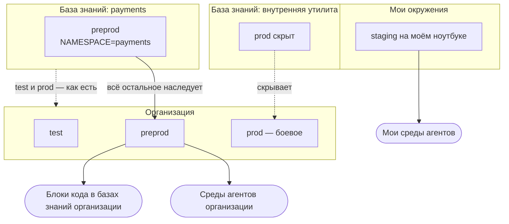
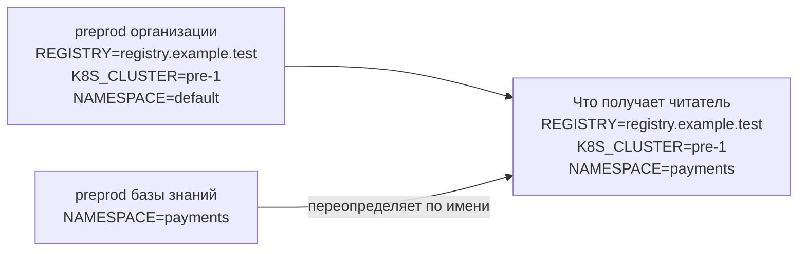

# Окружения и стенды

Окружение — именованный набор переменных с версиями: всё, из чего состоит стенд. Обычно это `test`, `preprod` и `prod`, но годятся и `мой ноутбук`, и `demo`. У каждой переменной есть имя, вид (см. «Виды переменных и секреты») и, у большинства видов, значение.

Окружение читают двое:

- **документация** — читатель выбирает стенд вверху базы знаний, и команды из блоков кода копируются с подставленными значениями этого стенда;
- **агенты** — среда агента ссылается на окружение, и агент вместе с setup-скриптом получает его переменные.

## Кому принадлежит окружение

| Владелец | Где | Кто читает | Кто правит |
|---|---|---|---|
| Организация | Настройки организации → **Environments** | все базы знаний организации, её среды агентов | владельцы и админы |
| База знаний | База знаний → **Connections** → **Environments** | блоки кода этой базы знаний | её админы |
| Вы | Settings → **Agents** → **My environments** | ваши собственные среды агентов | вы |

## Наследование: задать один раз, переопределить отличия

Большинство значений одинаковы для всех баз знаний организации: registry, кластер, SSO-хост. Поэтому окружения организации — базовые.

- База знаний без собственных окружений просто использует окружения организации в её порядке.
- **Override** на унаследованном окружении создаёт копию базы знаний, где хранятся только отличия, обычно `NAMESPACE`. Всё остальное по-прежнему берётся из организации, включая последующие изменения.
- База знаний может добавить переменные, которых нет у организации, или завести собственное окружение без базового (`demo`).
- **Hide** убирает унаследованное окружение из одной базы знаний, например у внутренней утилиты нет `prod`.
- **Замок** ставится на переменную организации, которая не должна различаться (например, `SSO_HOST` на prod), флажком **Knowledge bases may not override it** под переменной. База знаний показывает её только для чтения, с замком, а личное значение читателя не заменяет её в скопированной команде.
- Связь идёт по идентификатору, а не по имени: переименование `preprod` в организации не ломает построенные на нём базы знаний.

## Боевое окружение

Отметьте окружение флажком **Production**, и оно будет красным везде, где его выбирают. Блоки кода, заполненные из него, получают красную полосу, а запуск команды из такого блока в терминале десктопа сначала показывает команду и просит подтверждения.

## Версии

Каждое сохранение — новая версия. Задача, над которой уже работает агент, остаётся на той версии, с которой стартовала, поэтому правка `preprod` не меняет значения под работающей задачей. Новые значения получит следующая задача.

## Кто что видит

- **Имена** окружений и переменных — все, кто может читать базу знаний, включая анонимных читателей публичной базы. Без имён страница не сможет показать, что она подставит.
- **Значения** — только участники. Анонимные читатели публичной базы знаний их не получают.
- **Секреты** людям не показываются вовсе. На тестовом стенде секрет можно открыть флажком **Those who manage it may show it**: у тех, кто может править окружение, появляется кнопка с глазом, и каждое открытие записывается в журнал (кто, какая переменная, какая версия; само значение не пишется). Для боевых ключей флажок не ставьте.
