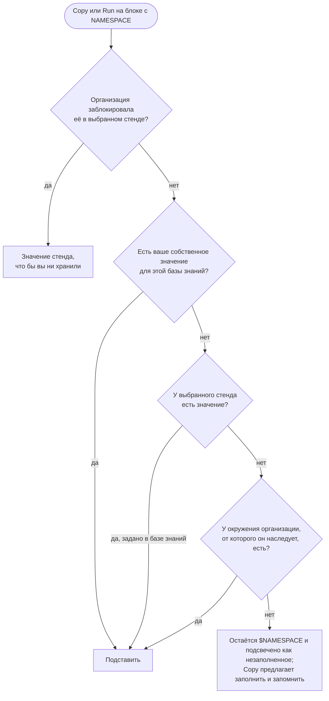
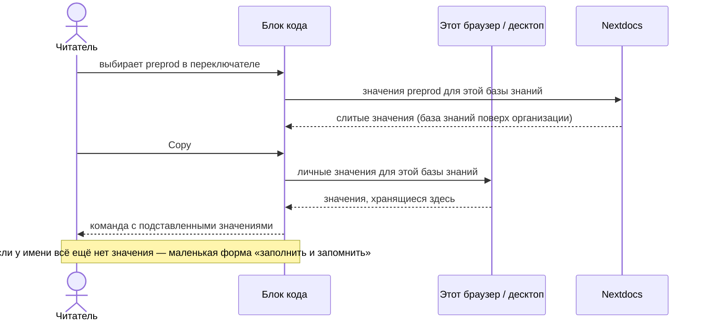

# Переменные в блоках кода

В документации полно команд вроде `kubectl -n $NAMESPACE get pods`. Без подсказки каждый читатель копирует команду и правит её руками под свой стенд. С переменными автор один раз отмечает `NAMESPACE`, и каждый читатель копирует команду уже со своим значением.

## Автору: как отметить переменную

Выделите токен в блоке кода и нажмите на панели **Make the selection a variable**. Заменяются только имена, отмеченные так: в shell, Helm или Jinja `$X` часто должен остаться как есть, поэтому автоматически ничего не подставляется.

Для отмеченного имени `NAME` распознаются формы `$NAME`, `${NAME}`, `<NAME>`, `{{NAME}}` и `{{ NAME }}`.

Текст блока не меняется. В markdown (на GitHub, в экспорте) блок остаётся рабочей командой, а отмеченные имена записываются после языка:

````
```bash vars=API_HOST,NAMESPACE
kubectl -n $NAMESPACE port-forward svc/api 8080 && curl https://$API_HOST/health
```
````

## Читателю: откуда берётся значение

Выберите стенд переключателем окружений вверху базы знаний. Дальше для каждого отмеченного имени берётся первое найденное значение:



Исключение — переменная, заблокированная организацией: всегда побеждает значение стенда, поэтому `SSO_HOST` на prod не подменит значение, оставшееся у кого-то от другого стенда.

## Что происходит при нажатии Copy



## Где хранятся ваши собственные значения

Личные значения в Nextdocs не уходят:

- в **десктопе** их хранит системная связка ключей, включая секреты;
- в **браузере** они остаются только в этом браузере, и только несекретные.

Выбранный стенд тоже запоминается для каждой базы знаний в браузере или в приложении.

## Агенты и блоки кода

Агент, читающий страницу, получает текст как он написан, отмеченные в каждом блоке имена и имена окружений базы знаний, но не значения. Значения агент, работающий над задачей, получает только через свою среду (см. «Среды агентов»).
