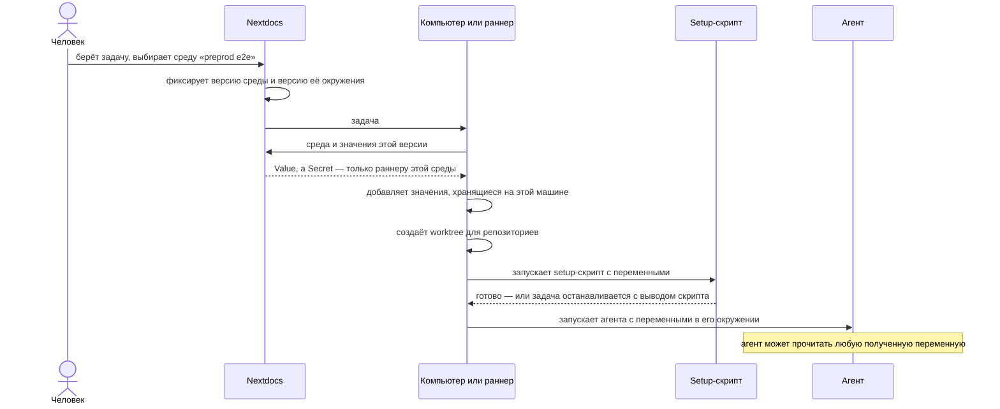
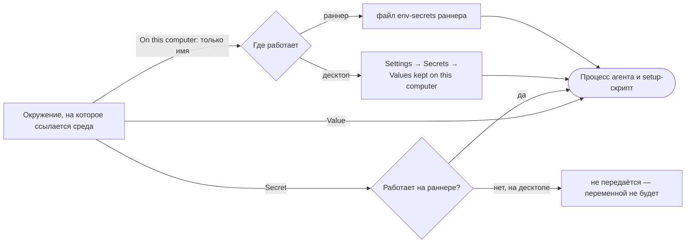

# Среды агентов

Среда агента (**Agent setup**) говорит, **где** агент работает над задачей. Её выбирают, когда берут задачу или передают её раннеру.

| Поле | Что решает |
|---|---|
| **Where** | Компьютер, который берёт задачу, или подключённый раннер |
| **Network access** | Полный доступ, только список доменов (менеджеры пакетов по желанию) или без сети |
| **Setup script** | Команды, которые выполняются в папке задачи до старта агента: `pnpm install`, `docker compose up -d postgres` |
| **Values from** | Окружение, переменные которого получат агент и скрипт |
| **Repositories** | Только эти репозитории можно планировать и менять; пусто — любые |

**Своих значений у среды нет.** Она ссылается на одно окружение того же владельца: среда организации — на окружение организации, ваша личная — на окружение из **My environments**. Поэтому `preprod` для агента — это ровно тот же `preprod`, что у читателя документации. Чтобы поменять значение, правьте окружение: все среды, которые на него ссылаются, получат изменение со следующей задачей.

## От взятия задачи до старта агента

Версии фиксируются в момент взятия задачи: правка среды или её окружения потом не меняет уже идущую задачу.

## Какие значения доходят до агента

Форма среды об этом предупреждает: **Secret** из выбранного окружения не доходит до среды, которая работает на компьютере, взявшем задачу. Храните такую переменную как **On this computer** или запускайте среду на раннере.

Часть имён раннер держит за собой, и в окружении, которым пользуется среда, их быть не может: `PATH`, `HOME`, настройки прокси и всё, что начинается с `ANTHROPIC_`, `OPENAI_`, `GIT_`, `GITHUB_`, `NEXTDOCS_` и подобных. Среда не примет такое окружение, пока переменную не переименуют.

## Сеть: чем она не является

На компьютере или раннере ограничение сети — это договорённость с агентом (ему сообщают правило), а не изоляция: программу, которая правило игнорирует, ничто не остановит. Изоляция появится вместе с облачными контейнерами.

## Среды, созданные раньше

У среды, сохранённой до того, как среды стали брать значения из окружений, в **Values from** может стоять **Its own variables**. Она работает как раньше; чтобы перевести её на окружение, выберите его в этом поле.
