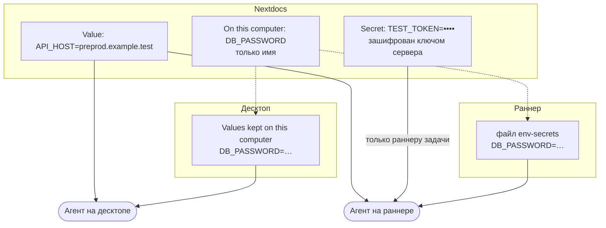

# Виды переменных и секреты

Каждая переменная окружения относится к одному из трёх видов. Вид решает, где хранится значение и кто вообще может его получить.

| Вид | Где значение | Читатели блоков кода | Агент на раннере | Агент на десктопе |
|---|---|---|---|---|
| **Value** | В Nextdocs, как введено | участники получают | получает | получает |
| **Secret** | В Nextdocs, зашифровано; больше не показывается | нет; те, кто правит окружение, могут открыть, если разрешено, с записью в журнал | получает | **не получает** |
| **On this computer** | Только на каждом компьютере или раннере; в Nextdocs — имя | своё значение, если задано | из файла env-secrets | из **Values kept on this computer** |

## Почему секрет не доходит до десктопа

Десктоп обращается к Nextdocs под вашей учётной записью, веб-страница тоже. Если бы зашифрованный секрет выдавался этой учётной записи, его могла бы прочитать любая открытая под ней страница. Поэтому зашифрованные секреты получает только раннер: у него своя идентичность, и выдаются они лишь для задачи, которую он выполняет. На десктопе храните секрет как **On this computer**.

## Значения на этом компьютере

Settings → **Secrets** → **Values kept on this computer** (десктоп) показывает все переменные вида **On this computer**, которые объявлены в ваших окружениях. Рядом с каждой стоит **set** или **missing** и указано, какому окружению она нужна. **Set** у недостающей переменной открывает ввод значения. Значения шифруются системной связкой ключей и покидают компьютер только в запуски агентов, которые он сам начинает.

Одно имя обслуживает все окружения, которые его объявляют: `DB_PASSWORD`, заданный здесь один раз, используется любым окружением с переменной **On this computer** с этим именем.

На раннере те же значения кладутся в файл `env-secrets` в его папке данных. Читать файл должен только владелец.

## Агент может их прочитать

Переменная любого вида в итоге становится обычной переменной окружения процесса агента. Агент может её прочитать, вывести и использовать в любой команде. Держите в окружениях только тестовые учётные данные. Если агент должен пользоваться логином или ключом, **не видя** его, это задача для учётных данных (**Credentials**).

В том, что запуск отправляет людям, наблюдающим за ним с другого устройства, точные значения секретов и значений с компьютера длиной от шести символов заменяются. Это ловит случайности, а не агента, который намеренно хочет вынести значение, и не мешает самому агенту им пользоваться.
