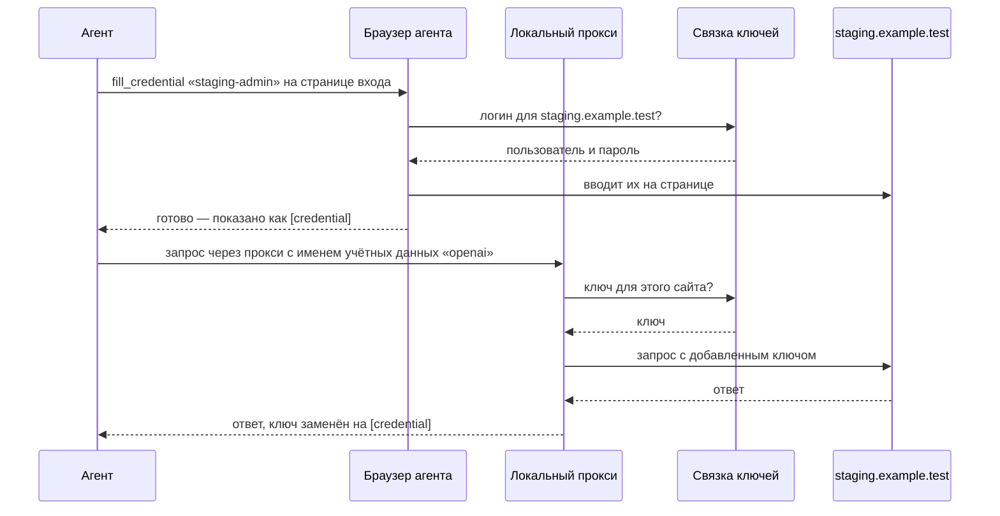
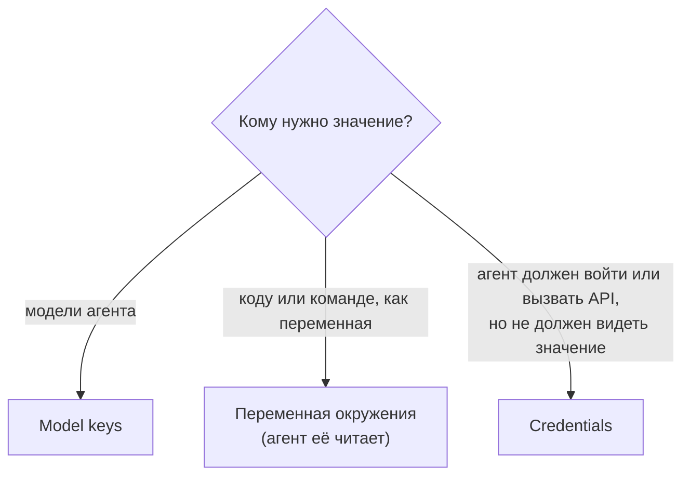

# Учётные данные и ключи моделей

В Settings → **Secrets** десктопа есть два вида ключей, которые вовсе не являются переменными окружения. Оба хранятся на этом компьютере, зашифрованные системной связкой ключей, и в Nextdocs не попадают. Различаются они тем, кто ими пользуется и может ли агент их прочитать.

| | Credentials (учётные данные) | Model keys (ключи моделей) |
|---|---|---|
| Для чего | Другие сайты, с которыми агент работает в задаче: логин админа staging, тестовый ключ платёжного провайдера | Сам агент, чтобы обращаться к своей модели: `ANTHROPIC_API_KEY`, `OPENAI_API_KEY`, `GEMINI_API_KEY`, `XAI_API_KEY` |
| Кто использует | Браузер агента и локальный прокси | CLI агента |
| Агент видит значение | **Нет** — только имя и сайты | **Да** — ключ лежит в окружении агента |
| Спрашивает разрешения | Перед использованием на сайте в чате, если не отключено | Нет |
| Оплата | — | Запуски оплачиваются по ключу, даже если CLI вошёл по подписке |

## Учётные данные: пользоваться, не читая

Учётные данные привязаны к своим сайтам: браузер вводит их только на странице одного из этих сайтов, а прокси добавляет только к запросам к ним. Всё, что возвращается агенту, показывает значение как `[credential]`.

## Ключи моделей: вместо входа в CLI

Ключ модели — альтернатива входу в CLI агента. Если пользуетесь подпиской провайдера, оставьте поле пустым: ключ имеет приоритет, и запуски будут оплачиваться с него. С ключом агента можно выбрать, даже если в его CLI никто не входил.

Ключ попадает в окружение агента, поэтому любая команда, которую агент запускает, может его прочитать.

## Что выбрать

