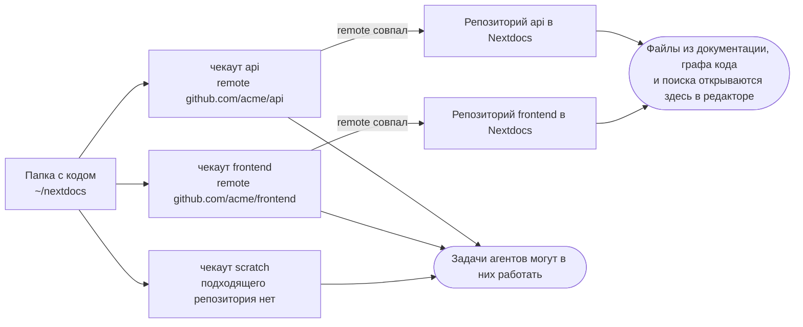

# Код на этом компьютере

Settings → **Desktop** → **Code on this computer** сообщает десктопу, где лежат ваши чекауты. Настройка хранится только на этом компьютере, пути в Nextdocs не уходят.

## Папки, чекауты, репозитории

1. **Add folder…** — укажите папку, в которой лежит несколько чекаутов. Приложение найдёт внутри все git-чекауты.
2. **Задачи агентов** видят все найденные чекауты. Заметка под папкой («Nextdocs: все сервисные репозитории; frontend — это nextdocs-front») передаётся агентам, когда они планируют работу.
3. **Привязка.** Чекаут, чей remote совпадает с репозиторием в Nextdocs, привязывается к нему автоматически. В списке чекаутов такие зелёные. У серого чекаута в Nextdocs нет репозитория с таким remote: задачам агентов он по-прежнему доступен, просто привязывать его не к чему.
4. **Repositories linked to a folder here** показывает привязки. **Change** указывает репозиторию другую папку, **Unlink** снимает привязку. Привязать репозиторий можно и вручную, на его собственной странице.

**Picked by hand before** — отдельные чекауты, которые вы раньше выбирали вне папок с кодом. Когда их начнёт покрывать папка с кодом, их можно убрать.

## Когда это используется

- **Взятие задачи** — worktree задачи создаются из найденных здесь чекаутов.
- **Открыть в редакторе** — место в файле из документации, графа кода или результата поиска открывается в редакторе, выбранном в **Editor**, внутри привязанной папки.
