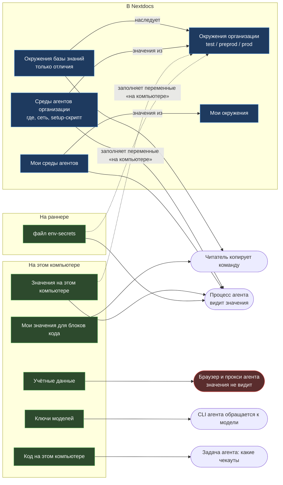

# Окружения, среды агентов и секреты

Значения в Nextdocs хранят несколько настроек: окружения, среды агентов, учётные данные, ключи моделей, значения на компьютере и папки с кодом. Названия похожи, но каждая отвечает на свой вопрос. Здесь все они показаны на одной схеме, а на страницах ниже разобраны по отдельности: как устроены и в какой момент используются.

Интерфейс приложения на английском, поэтому названия кнопок и разделов даны так, как они выглядят на экране.

## Схема

Синим отмечено то, что хранится в Nextdocs, зелёным — то, что лежит только на устройстве. Красный узел — единственный путь, которым агент пользуется значением, не видя его.

## Две мысли, которые всё разводят

**Окружение — это значения, среда агента — это место.** Окружение (test, preprod, prod) — именованный набор переменных: `API_HOST`, `NAMESPACE`, тестовый токен. Среда агента (**Agent setup**) говорит, где работает агент: на каком компьютере, куда ему можно ходить по сети, какой скрипт выполнить перед стартом, какие репозитории трогать. Своих значений у среды нет: она ссылается на окружение. Поэтому preprod определяется один раз, и читатель, копирующий команду из документации, и агент, работающий над задачей, получают одни и те же значения.

**У секрета главное — может ли агент его прочитать.** Всё, что попадает в процесс агента (переменные окружения, значения на компьютере, ключи моделей), он может прочитать, вывести и отправить дальше. Только учётными данными (**Credentials**) агент пользуется, не видя их.

## Что куда класть

| Что у вас есть | Куда положить | Кто использует | Агент может прочитать |
|---|---|---|---|
| Хост стенда, namespace, registry | Окружение, вид **Value** | читатели блоков кода, агенты | да |
| Тестовый токен, общий для организации | Окружение, вид **Secret** | агенты на раннерах; те, кто правит окружение, — если разрешено | да, на раннере |
| Пароль, у каждого человека или машины свой | Окружение, вид **On this computer** + значение на каждом компьютере | агенты на этом компьютере или раннере | да |
| Логин или API-ключ к другому сайту, которым агент должен пользоваться, не видя его | **Credentials** | браузер и прокси агента | **нет** |
| API-ключ Claude, OpenAI, Gemini, xAI | **Model keys** | сам CLI агента | да |
| Где лежат ваши чекауты | **Code on this computer** | задачи агентов, «открыть в редакторе» | — |

## Где это в настройках

| Настройка | Где | Хранится |
|---|---|---|
| Окружения организации | Настройки организации → **Environments** | в Nextdocs |
| Среды агентов организации | Настройки организации → **Agents** → **Agent setups** | в Nextdocs |
| Окружения базы знаний | База знаний → **Connections** → **Environments** | в Nextdocs |
| Мои окружения, мои среды агентов | Settings → **Agents** | в Nextdocs, под вашей учётной записью |
| Учётные данные, ключи моделей, значения на компьютере | Settings → **Secrets** (десктоп) | на этом компьютере, зашифровано системной связкой ключей |
| Код на этом компьютере | Settings → **Desktop** (десктоп) | на этом компьютере |

Под описанием каждого блока настроек, который хранит значения, стоят три одинаковые строки: **Used by** (кто использует), **Kept** (где хранится), **The agent** (видит ли агент). По ним два похожих блока различаются с первого взгляда, не нужно перечитывать оба абзаца.

## Страницы этого раздела

- **Окружения и стенды** — окружения организации, базы знаний и личные; наследование, заблокированные и боевые переменные.
- **Переменные в блоках кода** — как автор отмечает переменную и откуда читатель получает значение.
- **Среды агентов** — что происходит между взятием задачи и стартом агента.
- **Виды переменных и секреты** — Value, Secret, On this computer: кто что получает.
- **Учётные данные и ключи моделей** — два вида ключей, которые не являются переменными окружения.
- **Код на этом компьютере** — папки с кодом и привязанные к ним репозитории.
